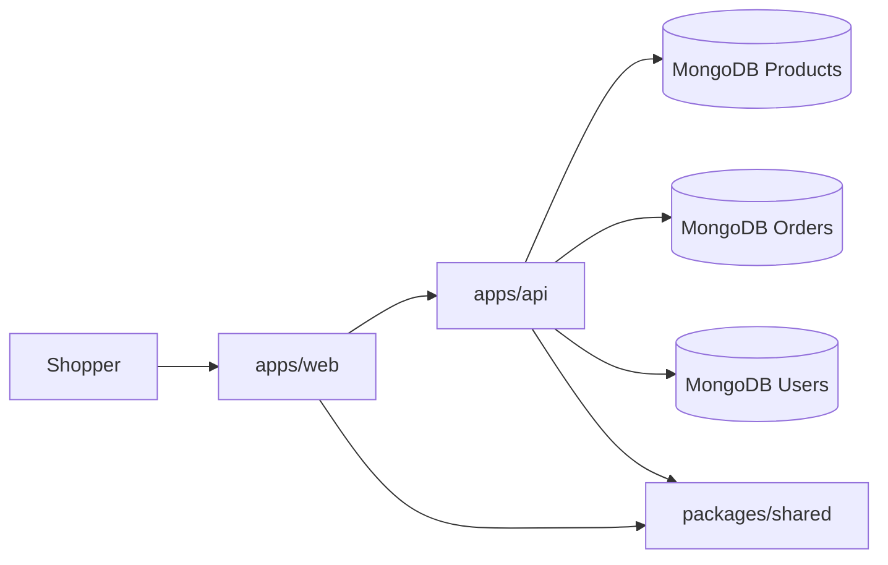

# 🛍️ JMart


Premium ecommerce storefront for the Ethiopian market, built as a polished monorepo with a React/Vite frontend, Express/MongoDB API, shared domain types, authentication, and a mock checkout flow.

## ✨ Highlights

- 🎨 Premium storefront UI with light and dark themes
- 🌍 English + Amharic ready layout and shared locale support
- 🛒 Product catalog, product detail, cart drawer, and checkout flow
- 🔐 Phone/password authentication with JWT sessions and account management
- 🖼️ Multi-image product galleries with zoom and related products
- 💳 Mock Chapa payment handoff and receipt screen
- 🗄️ MongoDB-backed products, users, orders, comments, and favorites
- 🛟 Shared fallback catalog when the API or database is unavailable
- ⚡ Fast local development with Vite and workspace scripts
- 🧩 Shared contracts across frontend and backend

## 🧱 Project Structure

```text
apps/
	web/      # React + Vite storefront
	api/      # Express API with auth, product, order, and payment routes
packages/
	shared/   # Shared types, catalog data, schemas, and translations
```

## 🗺️ How It Fits Together



## 🚀 Prerequisites

- Node.js 20 or newer
- npm 10 or newer
- MongoDB connection string for persistent data

## 🚀 Quick Start

```powershell
npm install
```

Create `apps/api/.env` for local API development:

```env
MONGODB_URI=mongodb://127.0.0.1:27017/jmart
PORT=4000
JWT_SECRET=replace-with-a-long-random-secret
```

For the deployed frontend, configure `VITE_API_URL` in Vercel:

```env
VITE_API_URL=https://your-api-service.onrender.com
```

Do not commit either `.env` file or real credentials. `VITE_API_URL` should be the API origin only; do not append `/api`.

Start the API and web app in separate terminals:

```powershell
npm run dev:api
npm run dev:web
```

Then open the Vite URL shown in the terminal. The local frontend uses relative `/api` requests when `VITE_API_URL` is not set. When it is set, requests are sent directly to that API origin.

## 🛠️ Scripts

| Command | What it does |
| --- | --- |
| `npm run dev:web` | Starts the storefront dev server |
| `npm run dev:api` | Starts the backend API server |
| `npm run build` | Builds all workspaces |
| `npm run lint` | Runs linting across the repo |
| `npm run typecheck` | Runs TypeScript checks across the repo |

The production build is intentionally ordered as `shared → api → web` because both applications consume the compiled `@jmart/shared` package:

```powershell
npm run build
```

## 📦 Apps

### `apps/web`

The customer-facing storefront. It includes:

- animated homepage sections
- catalog search, filter, and sort
- product detail pages
- cart drawer and checkout
- receipt / success screen

### `apps/api`

The Express API that powers authentication, product browsing and creation, comments, favorites, order creation, and mock payment state updates.

Health check:

```text
GET /health
```

API route groups:

| Route | Purpose |
| --- | --- |
| `/api/auth` | Register, login, profile, password, favorites |
| `/api/products` | Product listing, details, creation, and comments |
| `/api/orders` | Order creation and order lookup |
| `/api/payments` | Mock payment actions |

### `packages/shared`

Shared types, validation schemas, translations, and fallback catalog data used by both the web app and the API.

## 🛒 Storefront Features

<details>
<summary><strong>Homepage</strong></summary>

- rotating hero product spotlight
- category cards
- best-seller section
- checkout preview
- premium footer

</details>

<details>
<summary><strong>Catalog</strong></summary>

- real product cards
- search by name, description, and tags
- featured / new arrival / in-stock filtering
- price and rating sorting

</details>

<details>
<summary><strong>Checkout</strong></summary>

- Ethiopia-first shipping fields
- mock Chapa payment seam
- receipt page with order status polling

</details>

<details>
<summary><strong>Authentication</strong></summary>

- phone and password registration/login
- JWT token persistence in the browser
- profile and password updates
- favorites synced with the API

</details>

## 🎨 Design Direction

- Soft gradients instead of flat blocks
- Glass-like header and footer surfaces
- Motion used for emphasis, not noise
- Premium typography and spacing for a more boutique feel

## 🧪 Development Notes

- MongoDB is the primary source for products, users, orders, comments, and favorites.
- The storefront falls back to cached products and the shared catalog when the API is unavailable.
- Homepage sections, hero slides, product details, and related products use API products first.
- The API has a local MongoDB fallback URI, but production should always provide `MONGODB_URI`.
- `JWT_SECRET` must be a strong, private value and should be different between local development and production.
- The web app uses `VITE_API_URL` at build time for deployed API requests.
- `apps/web/public/favicon.svg` provides the JMart browser tab icon.

## ☁️ Deployment

JMart is designed to deploy as two services:

### Render API

1. Create a Render Web Service from the repository.
2. Build command:

   ```text
   npm install && npm run build
   ```

3. Start command:

   ```text
   node apps/api/dist/server.js
   ```

4. Add these Render environment variables:

   ```text
   MONGODB_URI=<production MongoDB connection string>
   JWT_SECRET=<strong production secret>
   ```

   Render provides `PORT` automatically.

### Vercel web app

1. Import the repository into Vercel.
2. Set the project root to the repository root.
3. Set the build command to:

   ```text
   npm run build
   ```

   The root build configuration builds the shared package before the API and web packages.
4. Set the output directory to:

   ```text
   apps/web/dist
   ```

5. Add this environment variable:

   ```text
   VITE_API_URL=https://<your-render-service>.onrender.com
   ```

6. Redeploy after changing environment variables.

The root `vercel.json` contains the SPA rewrite needed for routes such as `/login`, `/register`, and `/catalog`.

## 📌 Roadmap

- Real Chapa webhook verification
- Admin dashboard for inventory and order tracking
- More product categories and brand sections
- Automated API and end-to-end tests

## 🤝 Contributing

1. Create a branch.
2. Make your changes.
3. Run `npm run build`.
4. Push and open a pull request.

## 📄 License

Private project for JMart development.