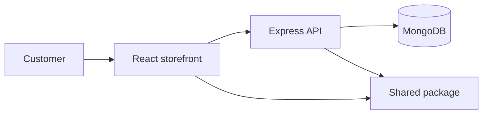

# JMart

JMart is a premium ecommerce platform designed for the Ethiopian market. It provides a modern shopping experience where customers can browse products, view detailed product information, manage a cart, create an account, and complete a checkout flow.

## What It Does

- Displays products from a MongoDB-backed API
- Uses a shared fallback catalog when the API is unavailable
- Lets customers browse, search, filter, and sort products
- Provides product detail pages with image galleries, zoom, variants, ratings, reviews, and related products
- Supports user registration, login, JWT authentication, profile management, and password changes
- Allows customers to save favorite products
- Provides a cart and Ethiopia-focused checkout experience
- Creates orders and displays a receipt with mock payment status updates
- Supports English and Amharic-ready content
- Includes light and dark themes with a responsive premium storefront design

## Main Features

### Product Catalog

- API-first product data
- Product search and filtering
- Featured, new-arrival, and in-stock categories
- Rating and price sorting
- Multiple product images with zoom controls
- Product variants and stock information
- Related product recommendations

### Authentication and Accounts

- Phone and password registration
- JWT-based login sessions
- Account profile updates
- Password changes
- Saved favorites
- Protected account and order information

### Cart and Checkout

- Add products and variants to the cart
- Adjust quantities and remove items
- Ethiopia-focused shipping address fields
- Order creation through the API
- Mock Chapa checkout flow
- Receipt page with payment status polling

## Technical Stack

- **Frontend:** React 19, TypeScript, Vite, Tailwind CSS, Framer Motion
- **Backend:** Node.js, Express 5, TypeScript
- **Database:** MongoDB with Mongoose
- **Authentication:** JSON Web Tokens and bcrypt
- **Validation:** Zod
- **Architecture:** npm workspaces monorepo
- **Shared code:** TypeScript types, schemas, translations, and catalog data
- **Deployment:** Vercel for the frontend and Render for the API

## Project Structure

```text
apps/
  web/      React and Vite storefront
  api/      Express and MongoDB backend

packages/
  shared/   Shared types, schemas, translations, and fallback catalog
```

## Architecture



The frontend uses the backend API as its primary data source. Shared TypeScript contracts keep product, user, order, and checkout data consistent between the frontend and backend.
